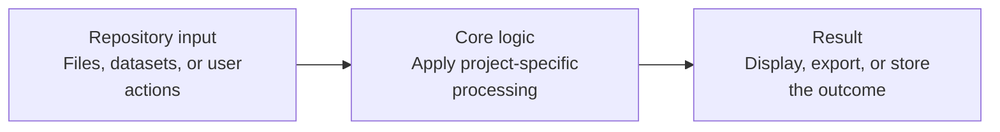

# HackerRankAutomationAsyncAwait

**Learning archive** · A browser automation practice project using asynchronous JavaScript patterns.

## Overview

A browser automation practice project using asynchronous JavaScript patterns.

## Technology Stack

- `Node.js`
- `Puppeteer`
- `JavaScript`

## How the Repository Works

| Stage | Responsibility |
|---|---|
| **Repository input** | Files, datasets, or user actions |
| **Core logic** | Apply project-specific processing |
| **Result** | Display, export, or store the outcome |

## Concepts Covered

- JavaScript runtime
- Asynchronous I/O
- Modules and packages
- HTTP or CLI workflows
- External integrations

## Repository Map

- `codes.js`
- `hk.js`
- `package-lock.json`
- `package.json`

## Recruiter Summary

This repository shows hands-on practice, iterative learning, and problem-solving across the technologies listed above. It is most useful as evidence of foundational growth and experimentation rather than as a production release.

---

Documentation is concise and project-focused; source code was not modified.
