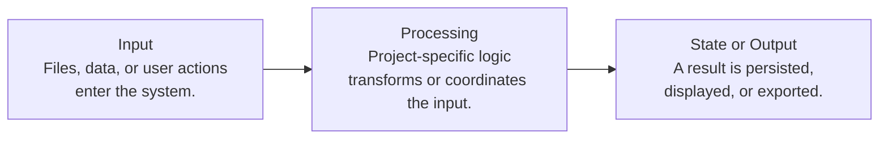

# HackerRankAutomationAsyncAwait

Demonstrates asynchronous browser automation for HackerRank tasks.

## Overview

This repository is maintained as a learning project or technical archive. It documents an implementation area, a set of practical exercises, or an experiment while preserving a focused and inspectable project structure.

## Key Features

- Node.js command execution or server runtime
- Modular source organization
- External I/O or API integration
- Scripted or interactive output

## Technology Stack

| Area | Technology |
|---|---|
| Platform | Node.js |
| Library / Framework / Tool | Puppeteer |
| Library / Framework / Tool | JavaScript |

## Architecture and Data Flow

| Stage | Responsibility |
|---|---|
| **Input** | Files, data, or user actions enter the system. |
| **Processing** | Project-specific logic transforms or coordinates the input. |
| **State or Output** | A result is persisted, displayed, or exported. |

## Repository Structure

- `codes.js`
- `hk.js`
- `package-lock.json`
- `package.json`

## Setup

1. Install Node.js and npm.
2. Run `npm install` from the repository root.
3. Start the project with the applicable script below.

## Usage

Run the repository entry point using the language or platform documented in the setup section.

## Configuration

Review `package.json` for available scripts and runtime dependencies. Add environment variables locally only when a feature requires external credentials or service configuration.

## Verification

- Run the project entry point and verify the primary success and error paths.
